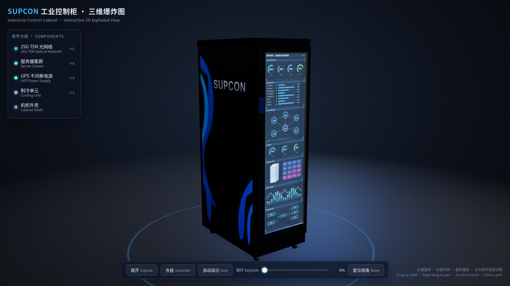
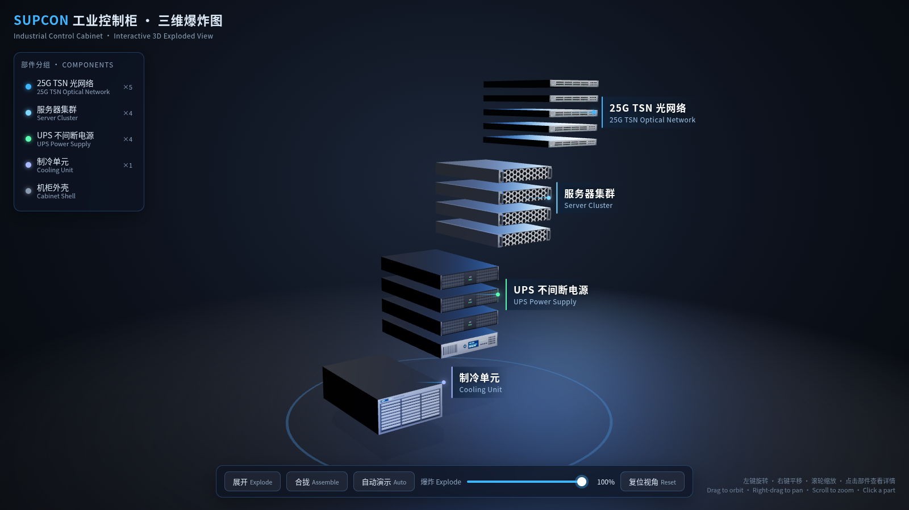

# SUPCON Nyx通用控制系统 · 三维爆炸图

交互式 Three.js 演示：中控（SUPCON）Nyx通用控制系统的三维爆炸视图。整页是仓库根目录的 `index.html`，通过 import map 从 jsDelivr 加载 Three.js，不依赖本地构建。

在线地址：<https://waynenb.github.io/cabinet-explode/>

## 操作

- **展开 / 合拢**：将柜内组件沿高度方向分开或收回
- **自动演示**：循环播放展开与合拢
- **滑块**：拖动「爆炸 Explode」控制展开程度（0%–100%）
- **复位视角**：恢复默认相机角度
- **鼠标**：左键旋转、右键平移、滚轮缩放
- **点击零件**：查看该部件说明（也可点击左侧部件分组）

部件包括 25G TSN 光网络、服务器集群、UPS 不间断电源、制冷单元和机柜外壳。

## 截图

合拢（0%）：

展开（100%）：

## 本地预览

用浏览器直接打开 `index.html`（需要能访问 jsDelivr）。根目录的空文件 `.nojekyll` 让 GitHub Pages 按原样发布这些静态文件。
